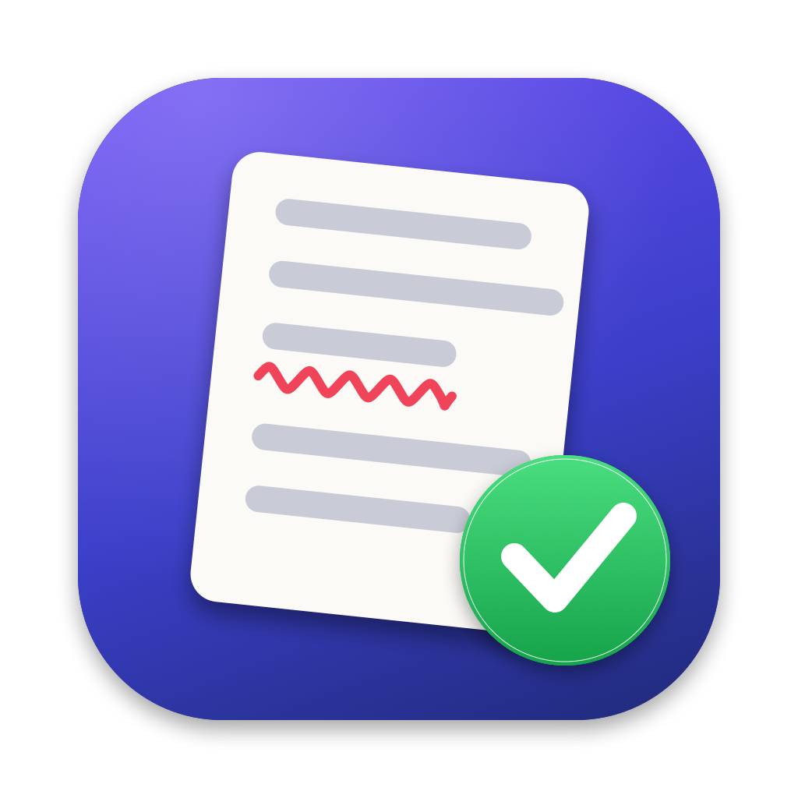

<p align="center"></p>

# Proofer

A tiny Mac notepad for proofreading messages with AI. Paste a message, press ⌘↩, and get a corrected version plus a short list of suggested improvements. Works with Anthropic (Claude), OpenAI, and Google Gemini using your own API key.

- **Notepad window:** paste on the left, results on the right, **Copy Corrected** to grab the fixed text.
- **Menu bar:** a compact proofreader is always one click away.
- **Global hotkey ⌃⌥⌘P:** copy text in any app, press the hotkey, and Proofer proofreads your clipboard.
- **Tone:** keep your own tone, or make the message casual, friendly, professional, or concise.

## Requirements

- macOS 14 (Sonoma) or later
- Apple's Command Line Tools (Swift 5.10 or newer). Install with `xcode-select --install`. The full Xcode app isn't needed.
- An API key from [Anthropic](https://console.anthropic.com/settings/keys), [OpenAI](https://platform.openai.com/api-keys), or [Google AI Studio](https://aistudio.google.com/apikey)

## Install

Proofer is distributed as source. Building it takes about a minute:

```sh
git clone https://github.com/jpowers/proofer.git
cd proofer
./build-app.sh --install
```

This builds `Proofer.app`, copies it into `/Applications`, and opens it. Run the same command again after pulling updates. To build without installing, run `./build-app.sh`; the app lands in `build/Proofer.app`.

Because you build it yourself, macOS opens it without the "unidentified developer" warning that downloaded unsigned apps get.

## Setup

1. Open **Settings** (⌘, or the gear button).
2. Choose a **provider** and paste your **API key**, then press Return or click **Save**.
3. Optionally pick a **model**. Click **Fetch models** to list the models your key can use.

Tip: create a separate key for Proofer with a monthly spending limit in your provider's console, so a lost key can't cost much and is easy to revoke.

## Usage

| How | Steps |
|---|---|
| Window | Paste text on the left, press ⌘↩, click **Copy Corrected**. |
| Hotkey | Copy text anywhere (⌘C), press **⌃⌥⌘P**, then **Copy Corrected**. |
| Menu bar | Copy text, click the ✓ icon, click **Paste & Proofread**. |

To launch Proofer at login, add it under System Settings → General → Login Items.

## Privacy

- **Your text** is sent only to the provider you selected, over HTTPS, and nowhere else. Proofer doesn't save your messages or the responses.
- **API keys** are saved in `~/Library/Application Support/Proofer/keys.json`, with permissions set so only your user account can read the file (the same approach as the `gh` and `aws` command-line tools). The file isn't encrypted by Proofer itself; turn on FileVault to encrypt it at rest. Proofer uses a file rather than the macOS Keychain because self-built, ad-hoc-signed apps get a new signature on every build, which would make the Keychain ask for your password after each update.
- If no key is saved, Proofer falls back to the `ANTHROPIC_API_KEY`, `OPENAI_API_KEY`, or `GEMINI_API_KEY` environment variable.

## Project layout

| Path | What it is |
|---|---|
| `Sources/Proofer/AIClient.swift` | The proofreading prompt and the streaming API calls for each provider |
| `Sources/Proofer/Provider.swift` | Provider list, default models, and where settings come from |
| `Sources/Proofer/ProofreadModel.swift` | Shared state and the tone options |
| `Sources/Proofer/KeyStore.swift` | API key storage |
| `Sources/Proofer/ContentView.swift`, `MenuBarView.swift`, `SettingsView.swift` | The UI |
| `Sources/Proofer/HotKey.swift` | The global hotkey |
| `scripts/make-icon.swift` | Draws the app icon; run `swift scripts/make-icon.swift` to regenerate it |
| `build-app.sh` | Builds and packages `Proofer.app` |

## Troubleshooting

- **Model not found:** model names change often. Open Settings, click **Fetch models**, and pick one from the list.
- **Hotkey does nothing:** another app may already use ⌃⌥⌘P, or a second copy of Proofer is running. Only one copy can own the hotkey.
- **Old icon in the Dock:** quit and reopen Proofer; macOS caches app icons.

## License

[MIT](LICENSE)
